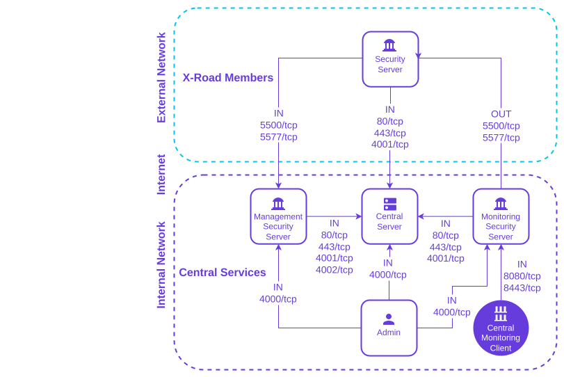

# X-Road 8: Central Server Installation Guide <!-- omit in toc -->

Version: 1.1
Doc. ID: IG-CS-8

---

## Version history <!-- omit in toc -->
| Date       | Version | Description                                                                                          | Author          |
|------------|---------|------------------------------------------------------------------------------------------------------|-----------------|
| 07.10.2025 | 1.0     | Initial version                                                                                      | Justas Samuolis |
| 11.11.2026 | 1.1     | Document the TLS certificate names, the per-node rows, the node name check, the default node name and the shared rows of a standalone server | Ričardas Bučiūnas |


## Table of Contents <!-- omit in toc -->

<!-- toc -->
<!-- vim-markdown-toc GFM -->

- [License](#license)
- [1. Introduction](#1-introduction)
  - [1.1 Target Audience](#11-target-audience)
  - [1.2 Terms and abbreviations](#12-terms-and-abbreviations)
  - [1.3 References](#13-references)
- [2. Installation](#2-installation)
  - [2.1 Prerequisites to Installation](#21-prerequisites-to-installation)
  - [2.2 Reference Data](#22-reference-data)
    - [2.2.1 Network Diagram](#221-network-diagram)
  - [2.3 Requirements to the Central Server](#23-requirements-to-the-central-server)
  - [2.4 Preparing OS](#24-preparing-os)
  - [2.5 Setup Package Repositories](#25-setup-package-repositories)
  - [2.6 Package Installation](#26-package-installation)
    - [2.6.1 Configuring TLS Certificates](#261-configuring-tls-certificates-for-global-configuration-distribution)
    - [2.6.2 Provisioning TLS Certificates for management services and user interface](#262-provisioning-tls-certificates-for-management-services-and-user-interface)
    - [2.6.3 Provisioning TLS Certificates for gRPC services](#263-provisioning-tls-certificates-for-grpc-services)
    - [2.6.4 Node name](#264-node-name)
  - [2.7 Pre-configuration for Registration Web Service](#27-pre-configuration-for-registration-web-service)
  - [2.8 Pre-configuration for Management Web Service](#28-pre-configuration-for-management-web-service)
  - [2.9 Post-Installation Checks](#29-post-installation-checks)
- [3 Initial Configuration](#3-initial-configuration)
- [4 Installation Error Handling](#4-installation-error-handling)
- [Annex A Central Server Default Database Properties](#annex-a-central-server-default-database-properties)
- [Annex B Database Users](#annex-b-database-users)
- [Annex C `xroad-secret-store-local` default configuration](#annex-c-xroad-secret-store-local-default-configuration)

<!-- vim-markdown-toc -->
<!-- tocstop -->

## License

This document is licensed under the Creative Commons Attribution-ShareAlike 3.0 Unported License. To view a copy of this license, visit http://creativecommons.org/licenses/by-sa/3.0/.

## 1. Introduction

### 1.1 Target Audience

The intended audience of this installation guide are the X-Road Central Server administrators responsible for installing and configuring the X-Road Central Server software.
The document is intended for readers with a good knowledge of Linux server management, computer networks, and the X-Road functioning principles.

### 1.2 Terms and abbreviations

See X-Road terms and abbreviations documentation \[[TA-TERMS](#Ref_TERMS)\].

### 1.3 References

1. <a id="Ref_UG-CS" class="anchor"></a>\[UG-CS\] X-Road 7. Central Server User Guide. Document ID: [UG-CS](ug-cs_x-road_6_central_server_user_guide.md) 
2. <a id="Ref_IG-SS" class="anchor"></a>\[IG-SS\] X-Road 7. Security Server Installation Guide. Document ID: [IG-SS](ig-ss_x-road_v6_security_server_installation_guide.md)
3. <a id="Ref_UG-SS" class="anchor"></a>\[UG-SS\] X-Road 7. Security Server User Guide. Document ID: [UG-SS](ug-ss_x-road_6_security_server_user_guide.md)
4. <a id="Ref_TERMS" class="anchor"></a>\[TA-TERMS\] X-Road Terms and Abbreviations. Document ID: [TA-TERMS](../terms_x-road_docs.md).
5. <a id="Ref_UG-SYSPAR" class="anchor"></a>\[UG-SYSPAR\] X-Road: System Parameters User Guide. Document ID: [UG-SYSPAR]('ug-syspar_x-road_v6_system_parameters.md').
6. <a id="Ref_IG-CS" class="anchor"></a>\[IG-CS\] X-Road 7. Central Server Installation Guide. Document ID: [IG-CS](ig-cs_x-road_6_central_server_installation_guide.md)

## 2. Installation

### 2.1 Prerequisites to Installation

The Central Server software assumes an existing installation of the Ubuntu 24.04 LTS operating system, on an x86-64bit platform. To provide management services, a Security Server is installed alongside the Central Server.

The Central Server’s software can be installed both on physical and virtualized hardware.

### 2.2 Reference Data

Note: The information in empty cells will be determined at the latest during the server’s installation, by the person performing the installation.

Caution: Data necessary for the functioning of the operating system is not included.

| **Ref** |                                                                                                                                                                                                                                                                                                  | **Explanation**                                                                                                                                                                                                                                                                            |
|---------|--------------------------------------------------------------------------------------------------------------------------------------------------------------------------------------------------------------------------------------------------------------------------------------------------|--------------------------------------------------------------------------------------------------------------------------------------------------------------------------------------------------------------------------------------------------------------------------------------------|
| 1.0     | Ubuntu 24.04 (x86-64), 2 GB RAM, 3 GB free disk space                                                                                                                                                                                                                                            | Minimum requirements                                                                                                                                                                                                                                                                       |
| 1.1     | https://artifactory.niis.org/xroad8-snapshot-deb                                                                                                                                                                                                                                                 | X-Road package repository                                                                                                                                                                                                                                                                  |
| 1.2     | https://artifactory.niis.org/api/gpg/key/public                                                                                                                                                                                                                                                  | The repository key.<br /><br />Hash: `935CC5E7FA5397B171749F80D6E3973B`<br  />Fingerprint: `A01B FE41 B9D8 EAF4 872F  A3F1 FB0D 532C 10F6 EC5B`<br  />3rd party key server: [Ubuntu key server](https://keyserver.ubuntu.com/pks/lookup?search=0xfb0d532c10f6ec5b&fingerprint=on&op=index) |
| 1.3     | https://pkgs.openbao.org/deb                                                                                                                                                                                                                                                                     | OpenBao package repository                                                                                                                                                                                                                                                                 |
| 1.4     |                                                                                                                                                                                                                                                                                                  | Account name in the user interface                                                                                                                                                                                                                                                         |
| 1.5     | TCP 4001 service for authentication certificate registration<br>TCP 80 distribution of the global configuration<br>TCP 443 distribution of the global configuration                                                                                                                              | Ports for inbound connections (from the external network to the Central Server)                                                                                                                                                                                                            |
| 1.5.1   | TCP 4002 management services                                                                                                                                                                                                                                                                     | Port for inbound connections from the management Security Server                                                                                                                                                                                                                           |
| 1.6     | TCP 80, 443 software updates                                                                                                                                                                                                                                                                     | Ports for outbound connections (from the Central Server to the external network)                                                                                                                                                                                                           |
| 1.7     | TCP 80 HTTP between the Central Server and the management services' Security Server<br>TCP 443 HTTP between the Central Server and the management services' Security Server<br>TCP 4000 user interface<br>TCP 4002 HTTPS between the Central Server and the management services' Security Server | Internal network ports, the user interface port, and management service ports for the management services' Security Server                                                                                                                                                                 |
| 1.8     |                                                                                                                                                                                                                                                                                                  | Central Server internal IP address(es) and hostname(s)                                                                                                                                                                                                                                     |
| 1.9     |                                                                                                                                                                                                                                                                                                  | Central Server public IP address, NAT address                                                                                                                                                                                                                                              |
| 1.10    | <by default, the server’s host name is the common name and its IP addresses and names are the alternative names; the installation asks for them>                                                                                                                                                                                   | Information about the user interface TLS certificate                                                                                                                                                                                                                                       |
| 1.11    | <by default, the server’s host name is the common name and its IP addresses and names are the alternative names; the installation asks for them>                                                                                                                                                                                   | Information about the services TLS certificate                                                                                                                                                                                                                                             |
| 1.12    | <by default, the server’s IP addresses and names are added to the certificate’s Distinguished Name (DN) field>                                                                                                                                                                                   | Information about the global configuration TLS certificate                                                                                                                                                                                                                                 |

It is strongly recommended to protect the Central Server from unwanted access using a firewall (hardware or software based). The firewall can be applied to both incoming and outgoing connections depending on the security requirements of the environment where the Central Server is deployed. It is recommended to allow incoming traffic to specific ports only from explicitly defined sources using IP filtering. **Special attention should be paid with the firewall configuration since incorrect configuration may leave the Central Server vulnerable to exploits and attacks.**

#### 2.2.1 Network Diagram

The network diagram below provides an example of a basic Central Server setup.



The table below lists the required connections between different components. Please note that required connections between Security Servers and trust services (OCSP service, time-stamping service) have been omitted from the diagram and the table below. Their configuration is described in [IG-SS](#Ref_IG-SS).

| **Connection Type** | **Source**                        | **Target**                    | **Target Ports**    | **Protocol** | **Note**                                                                                                                                                                         |
|---------------------|-----------------------------------|-------------------------------|---------------------|--------------|----------------------------------------------------------------------------------------------------------------------------------------------------------------------------------|
| Out                 | Monitoring Security Server        | X-Road Member Security Server | 5500, 5577          | tcp          | Operational and environmental monitoring data collection                                                                                                                         |
| In                  | X-Road Member Security Server     | Central Server                | 80, 443             | tcp          | Global configuration distribution                                                                                                                                                |
| In                  | X-Road Member Security Server     | Central Server                | 4001                | tcp          | Authentication certificate registration requests from X-Road Members' Security Servers                                                                                           |
| In                  | Management Security Server        | Central Server                | 80, 443, 4001, 4002 | tcp          | Source in the internal network. Management service requests from Management Security Server. Global configuration distribution. Authentication certificate registration requests |
| In                  | Monitoring Security Server        | Central Server                | 80, 443, 4001       | tcp          | Source in the internal network. Global configuration distribution. Authentication certificate registration requests                                                              |
| In                  | Security Server                   | Central Server                | 6183, 6185, 6187    | tcp          | Issuer Service DID documents, credential issuance and credential status lists, reached through the cluster DNS name                                                               |
| In                  | X-Road Member Security Server     | Management Security Server    | 5500, 5577          | tcp          | Management service requests from X-Road Members' Security Servers                                                                                                                |
| In                  | Central Monitoring Client         | Monitoring Security Server    | 8080, 8443          | tcp          | Source in the internal network                                                                                                                                                   |
| In                  | Admin, management REST API client | Central Server                | 4000                | tcp          | Source in the internal network                                                                                                                                                   |
| In                  | Admin                             | Management Security Server    | 4000                | tcp          | Source in the internal network                                                                                                                                                   |
| In                  | Admin                             | Monitoring Security Server    | 4000                | tcp          | Source in the internal network                                                                                                                                                   |

The table below lists the open ports for Central Server components utilizing the _loopback_ interface. A loopback interface is a virtual network interface on a computer, facilitating self-communication for processes and applications. This enables local communication and the ports must be accessible locally.

| **Component**        | **Ports** | **Protocol** | **Note**                                      |
|----------------------|-----------|--------------|-----------------------------------------------|
| Registration Service | 8084      | tcp          | For incoming requests to Registration Service |
| Management Service   | 8085      | tcp          | For incoming requests to Management Service   |
| Issuer Service       | 6181      | tcp          | EDC default API and health check              |
| Issuer Service       | 5460      | tcp          | gRPC from the Central Server admin service     |
| PostgreSQL database  | 5432      | tcp          | Default PostgreSQL database port              |
| Signer               | 5560      | tcp          | Signer gRPC port                              |
| Audit log            | 514       | udp          |                                               |
| Secret Store         | 8200      | tcp          | Local Secret Store (OpenBao) port             |

The Issuer Service's public ports (6183, 6185, 6187) listen on the interface set by the
`xroad.dataspace.issuer.listen-address` property. The default is `0.0.0.0`; it and `::` both
listen on every interface, IPv4 and IPv6. Port 6181 always listens on 127.0.0.1 and the
property does not change it. Set a shared value, used by every node without its own value,
with:

```bash
sudo /usr/share/xroad/scripts/db_property.sh set --yes -- xroad.dataspace.issuer.listen-address <address>
```

Set a value for one node of a cluster instead with:

```bash
sudo /usr/share/xroad/scripts/db_property.sh set --yes --node <node> -- xroad.dataspace.issuer.listen-address <address>
```

On a single node with no node name configured, the node is `node_0`. The Issuer Service reads
the property once at startup, so restart it after a change:

```bash
sudo systemctl restart xroad-ds-issuer-service
```

**Caution:** a value other than `0.0.0.0`, `::` or a loopback address takes these ports off
loopback too, because the service then listens only on the interface named, and it can break a
haproxy backend that reaches these ports on loopback. The property has no validator: a mistyped
address does not fail the command that sets it, and shows up only as a bind failure when the
Issuer Service next starts.

### 2.3 Requirements to the Central Server

Minimum recommended hardware parameters:
- the server hardware (motherboard, CPU, network interface cards, storage system) must be supported by Ubuntu in general;
- a 64-bit dual-core Intel, AMD or compatible CPU;
- 2 GB RAM;
- 100 Mbps network interface card.

Requirements for software and settings:
- an installed and configured Ubuntu 24.04 LTS x86-64 operating system;
- the necessary connections are allowed in the firewall (reference data: 1.5; 1.5.1; 1.6; 1.7),
- if the Central Server has a private IP address, a corresponding NAT record must be created in the firewall (reference data: 1.9).

### 2.4 Preparing OS

- Add an X-Road system administrator user (reference data: 1.4) whom all roles in the user interface are granted to. 

  Add the new user with the command: `sudo adduser <username>`.

  User roles are discussed in detail in the X-Road Security Server User Guide [UG-SS](#Ref_UG-SS). Do not use the user name `xroad`, it is reserved for the X-Road system user.

- Ensure that the packages `locales` and `lsb-release` are present
  
  `sudo apt install locales lsb-release`

- Set the operating system locale.

  Add the following line to the file `/etc/environment`: `LC_ALL=en_US.UTF-8`  
  Ensure that the locale is generated: `sudo locale-gen en_US.UTF-8`

### 2.5 Setup Package Repositories

Add the X-Road repository’s signing key to the list of trusted keys (**reference data: 1.2**):
```bash
curl -fsSL https://x-road.eu/gpg/key/public/niis-artifactory-public.gpg | sudo tee /usr/share/keyrings/niis-artifactory-keyring.gpg > /dev/null
```

Add X-Road package repository (**reference data: 1.1**):
```bash
echo "deb [signed-by=/usr/share/keyrings/niis-artifactory-keyring.gpg] https://artifactory.niis.org/xroad8-snapshot-deb $(lsb_release -sc)-current main" | sudo tee /etc/apt/sources.list.d/xroad.list > /dev/null
```

Add OpenBao package repository (**reference data: 1.3**):
```bash
curl -fsSL https://openbao.org/assets/openbao-gpg-pub-20240618.asc | sudo tee /usr/share/keyrings/openbao-keyring.asc > /dev/null
echo "deb [signed-by=/usr/share/keyrings/openbao-keyring.asc] https://pkgs.openbao.org/deb/ stable main" | sudo tee /etc/apt/sources.list.d/openbao.list > /dev/null
```

### 2.6 Package Installation

Update package repository metadata:
```bash
sudo apt update
```

Issue the following command to install the Central Server packages:
```bash
sudo apt install xroad-centralserver
```

Upon the first installation of the Central Server software, the system asks for the following information.

- Account name for the user who will be granted the rights to perform all activities in the user interface (reference data: 1.4).

- Database server URL. Locally installed database is suggested as default.

- Whether the database migrations should be skipped and handled manually instead. Usually automatic migrations should be used, but for legacy database support (like BDR1) it's possible to rely on manual operations instead. How to execute the database migrations manually is described in [Annex E Run Database Migrations Manually](#annex-e-run-database-migrations-manually).

- Identification of the TLS certificate that is used for securing the HTTPS access point used for global configuration distribution (reference data: 1.8; 1.12). The name and IP addresses detected from the operating system are suggested as default values.

  The certificate owner’s Distinguished Name must be entered in the format: `/CN=server.domain.tld`.
  All IP addresses and domain names in use must be entered as alternative names in the format: `IP:1.2.3.4,IP:4.3.2.1,DNS:servername,DNS:servername2.domain.tld`

- The node name, on the first installation only, and only when `/etc/xroad/conf.d/node.ini` has no node name yet. Leave the answer empty for a standalone Central Server. Enter the name of the node when the server is a node of a high availability cluster. The installation checks the name before it writes anything, and stops with an error when the name does not follow the rule. See [2.6.4 Node name](#264-node-name) for the rule. The preseed key is `xroad-common/node-name`.

- Names of the TLS certificate of the user interface (reference data: 1.10) and of the TLS certificate of the management services (reference data: 1.11). The installation asks the common name and the alternative names of each certificate. The suggested value is the value that this node uses now: its own row in the configuration database, else the shared row. When there is no row, the preseeded answer is suggested, else the name and IP addresses that the installation detects from the operating system.

  Enter the common name as a plain host name or IP address, for example `server.domain.tld`.
  All IP addresses and domain names in use must be entered as alternative names in the format: `IP:1.2.3.4,IP:4.3.2.1,DNS:servername,DNS:servername2.domain.tld`

  The certificate gets exactly the names that are entered. The answers are stored in the configuration database and are used when the services create their keys, see [2.6.2 Provisioning TLS Certificates for management services and user interface](#262-provisioning-tls-certificates-for-management-services-and-user-interface). A key is stored only when it has no row yet, or when the answer differs from the value the node uses now. An unchanged answer writes nothing. A changed answer is stored as a row of the node when `node.ini` has a node name, and as a shared row otherwise. The preseed keys are `xroad-common/admin-subject`, `xroad-common/admin-altsubject`, `xroad-common/service-subject` and `xroad-common/service-altsubject`.

ATTENTION: Security Servers connect to the management services by the Central Server address in the global configuration (reference data: 1.9). A Security Server trusts the exact management services certificate that the Central Server publishes in the global configuration, whatever names the certificate carries, and it does not compare the address with the names in the certificate. The address therefore does not have to be in the certificate. Enter the names that other clients use to reach the node, for example a NAT address or a load balancer name. The names can also be changed after the installation. Follow the procedure in section [2.6.2](#262-provisioning-tls-certificates-for-management-services-and-user-interface).

#### 2.6.1 Configuring TLS Certificates for global configuration distribution

The installation process creates a self-signed TLS certificate for global configuration distribution. However, self-signed certificates are not recommended for production use, and should be substituted with certificate issued by a trusted Certificate Authority (CA).

To configure the Central Server to use a certificate issued by a trusted CA for serving global configurations over HTTPS, replace the existing certificate files (`global-conf.crt`) and its associated private key (`global-conf.key`), located in the `/etc/xroad/ssl/` directory.

Reload the nginx service for the certificate change to take effect.

```bash
systemctl reload nginx
```

#### 2.6.2 Provisioning TLS Certificates for management services and user interface

TLS certificates for the user interface and management services are automatically provisioned at the applications startup, using OpenBao PKI secrets engine (package `xroad-secret-store-local`).

Each node has its own keys. The user interface key is stored at `xrd-secret/tls/admin-service/<node>` and the management services key at `xrd-secret/tls/management-service/<node>`. `<node>` is the node name, see [2.6.4 Node name](#264-node-name).

The names in the certificates are the answers given during the installation, see [2.6 Package Installation](#26-package-installation). The installation detects the suggested names from the host and stores the answers in the configuration database. The services do not detect the host name or the addresses themselves.

The installation detects these names:

- The common name is the fully qualified host name (`hostname -f`). It is the short host name when the fully qualified name is longer than 64 characters.
- The DNS alternative names are the fully qualified and the short host name.
- The IP alternative names are the server's global-scope addresses. Loopback and link-local addresses are left out.

The answers are stored as rows of the node when `node.ini` has a node name, and as shared rows otherwise. A key that has no row uses a default: the common name is the value of the environment variable `XROAD_HOST`, or `localhost` when it is not set; there are no DNS alternative names; the IP alternative name is `127.0.0.1`. The defaults apply when no installation has stored rows, for example in container images. The installation stores no rows when systemd is not the running init, or when the environment variable `XROAD_IGNORE_DATABASE_SETUP` is set.

Each node resolves every key in this order: the row of the node, the shared row, the default.

Running `sudo dpkg-reconfigure xroad-center` asks the names again. The suggested value is the value the node uses now, except on a server without a node name that has a row set with `--node node_0`; see the next paragraph. A key is stored only when the answer differs from that value, in the scope of the node: as a node row when `node.ini` has a node name, as a shared row otherwise. A key that already exists keeps its names; delete it and restart the services as described below.

A server without a node name uses the node name `node_0`, so a row set with `db_property.sh --node node_0` wins over the shared row. On such a server the installation reads and writes shared rows only. It neither shows nor changes `node_0` rows. Set shared rows on a standalone server, without `--node`.

An upgrade follows the same rule as `dpkg-reconfigure`. A key that has a node row or a shared row and an unchanged answer is not written, so a shared row keeps applying to the node.

**Changing the certificate names**

Change the names when Security Servers or users reach the node by another name or address, for example a NAT address or a load balancer name. A service creates its key when it starts and the key is missing. A service reads the names once, when it starts. Changing the names in the configuration database therefore has no effect on a key that already exists. To get a certificate with new names, set the names, delete the key and restart the services that use it.

1. Set the names in the configuration database. For the management services certificate, use the keys `xroad.management-service.tls.certificate-provisioning.*`:

   ```bash
   sudo /usr/share/xroad/scripts/db_property.sh set xroad.management-service.tls.certificate-provisioning.common-name cs.example.org --yes
   sudo /usr/share/xroad/scripts/db_property.sh set xroad.management-service.tls.certificate-provisioning.alt-names cs.example.org --yes
   sudo /usr/share/xroad/scripts/db_property.sh set xroad.management-service.tls.certificate-provisioning.ip-subject-alt-names 203.0.113.10 --yes
   ```

   For the user interface certificate, use the keys `xroad.admin-service.tls.certificate-provisioning.*`.

   These rows are shared: they apply to every node that has no row of its own for the key. A node that has a node name usually has node rows already, because the installation stores a node row for every name that had no row, or that was changed. On a first installation with no rows set earlier, that is all six names. A node row wins over the shared row, so a shared row does not apply to such a node. To make the node use the shared row, remove the node row, for example `db_property.sh remove xroad.management-service.tls.certificate-provisioning.common-name --node node_1`. To avoid this, set the shared rows before the node is installed: the installation then suggests them and stores nothing for an unchanged answer.

   To set a key for one node only, add `--node <node>`, where `<node>` is the node name, see [2.6.4 Node name](#264-node-name). Node rows are for a cluster, where each node can have its own names:

   ```bash
   sudo /usr/share/xroad/scripts/db_property.sh set xroad.management-service.tls.certificate-provisioning.common-name cs-1.example.org --node node_1 --yes
   sudo /usr/share/xroad/scripts/db_property.sh set xroad.management-service.tls.certificate-provisioning.alt-names cs-1.example.org,cs.example.org --node node_1 --yes
   ```

   Each node resolves every key on its own, in this order: the row of the node, the shared row, the default. A node can therefore use its own common name together with the shared alternative names.

   For node 2 and later of a cluster, the rows can be set from an existing node before the new node is installed, because the configuration database already exists. The new node reads the rows when it creates its key at the first start.

   To check the rows, run `db_property.sh get <key>` for the shared row and `db_property.sh get <key> --node <node>` for the row of a node. `db_property.sh list --node <node>` shows all rows of a node. To make a node use the shared row again, run `db_property.sh remove <key> --node <node>`; the row of the node is deleted and the shared row applies.

2. Delete the key of the certificate. Do this and the next step on each node whose names changed: after a change of a shared row, that is every node without a row of its own for the key. The commands use the OpenBao command line tool `bao`. With the local secret store, the address is `https://127.0.0.1:8200` and the token is in `/etc/openbao/root-token`. If `bao` does not trust the secret store certificate, set `BAO_CACERT` to the CA certificate file. Replace `<node>` with the node name, `node_0` when the name is not set:

   ```bash
   export BAO_ADDR=https://127.0.0.1:8200
   export BAO_TOKEN=$(sudo cat /etc/openbao/root-token)
   bao kv delete xrd-secret/tls/management-service/<node>
   ```

   For the user interface certificate, delete `xrd-secret/tls/admin-service/<node>` instead.

3. Restart the services that use the key. The first service in each list creates the new key, so start it first:

   - Management services certificate: `xroad-center-management-service`, then `xroad-center-registration-service`. The user interface service `xroad-center` reads this key whenever it needs it, so it uses the new key without a restart. It reads the management services names once, when it starts. If you create the key with "Re-create key" in the user interface after a row change, restart `xroad-center` first. Otherwise the new key gets the old names.
   - User interface certificate: `xroad-center`, then `xroad-center-management-service` and `xroad-center-registration-service`. The two services connect to `xroad-center` and trust its certificate from the key.

   Example for the management services certificate:

   ```bash
   sudo systemctl restart xroad-center-management-service
   sudo systemctl restart xroad-center-registration-service
   ```

4. Check the new certificate. For the user interface certificate, open the user interface in a Web browser and view the certificate. For the management services certificate, see [UG-CS](#Ref_UG-CS) section "Registration and Management Service TLS certificate".

After a new management services certificate is created, the management services' Security Server must trust it. Add it as an internal TLS certificate on that Security Server, see [UG-SS](#Ref_UG-SS) section "Managing Information System TLS Certificates".

#### 2.6.3 Provisioning TLS Certificates for gRPC services

TLS certificates for gRPC services are provisioned and rotated automatically, using OpenBao PKI secrets engine (package `xroad-secret-store-local`).

#### 2.6.4 Node name

The node name tells Central Server nodes apart when they share one secret store. The Central Server uses it in secret store paths and, when it is set, in the names of backup archives.

A standalone Central Server does not need a node name. Set one on every node of a high availability cluster, see the [Central Server High Availability Installation Guide](ig-csha_x-road_6_ha_installation_guide.md).

- Where to set it:
  - Native packages: the key `name` in the `[node]` section of `/etc/xroad/conf.d/node.ini`. The first installation asks for the name and writes the file when the answer is not empty. The question is skipped when `node.ini` already has a name, so the file can also be created before installing the packages. The directory does not exist before the first installation, so create it first with `sudo mkdir -p /etc/xroad/conf.d`. The package sets the ownership of the directory and its files when it is installed. Upgrades and `dpkg-reconfigure` do not ask for the name.
    ```ini
    [node]
    name=node_1
    ```
  - Containers: the environment variable `XROAD_NODE_NAME`.
- The rule:
  - Use 1 to 63 characters: letters, digits, `_` and `-`.
  - The first character must be a letter or a digit.
  - The name is read as plain text, so values such as `01`, `007` and `true` are valid.
- What it selects:
  - The node's keys in the secret store.
  - The node's configuration rows: a row set with `db_property.sh --node <node>` applies only to the node with that name, and only while the node has that name. See [IG-CS](ig-cs_x-road_6_central_server_installation_guide.md#28-installing-the-support-for-hardware-tokens) section 2.8, "Per-node values".
- If the name is not set:
  - The services use the name `node_0` in secret store paths.
  - Backup archive names have no node name suffix.
  - `node_0` is the default name of an initialized Central Server that is not clustered. The server does not report itself as clustered.
- To turn a standalone Central Server into node 1 of a cluster, set `name=node_0` in `node.ini`. The server keeps its keys in the secret store, because they are already stored under `node_0`. It keeps its configuration rows too: the installation and the migration from X-Road 7 write shared rows, and shared rows keep applying to the node. Nothing is moved. From then on the server reports itself as clustered. See the [Central Server High Availability Installation Guide](ig-csha_x-road_6_ha_installation_guide.md) for the other steps.
- The installation checks the name that is entered at the prompt before it writes anything. A name that does not follow the rule stops the installation with an error, and neither `node.ini` nor any configuration row is written. Enter a valid name and run the installation again. The installation also stops when `node.ini` exists but cannot be read.
- The installation does not check a name that is already in `node.ini`. The services check it when they start. A node with a name that does not follow the rule does not start, and the message in the service log names the rule.
- Do not change the name after the node has been used. See the [Central Server High Availability Installation Guide](ig-csha_x-road_6_ha_installation_guide.md#41-node-name-and-renaming-a-node) for how to rename a node and move its configuration rows.

### 2.7 Pre-configuration for Registration Web Service

The registration web service is installed by package `xroad-center-registration-service`. The package is included in the Central Server installation by default.

Configuration parameters for registration web service are specified in the [UG-SYSPAR](#Ref_UG-SYSPAR) section "Registration service parameters".

**Note:** With new registration service, a maximum size limit (MAX_REQUEST_SIZE = 100 KB) is set for the authentication certificate SOAP message.

### 2.8 Pre-configuration for Management Web Service
The management web service is installed by package `xroad-center-management-service`. The package is included in the Central Server installation by default.

Configuration parameters for management web service are specified in the [UG-SYSPAR](#Ref_UG-SYSPAR) section "Management service parameters".

### 2.9 Post-Installation Checks

The installation is successful if the system services are started and the user interface is responding.

-   Ensure from the command line that relevant X-Road services are in the `running` state (example output follows). Notice that it is normal for the `xroad-confclient` to be in `stopped` state on the Central Server since it operates in one-shot mode. `xroad-secret-store-local` is run once to initialize OpenBao and then stops.
    ```bash
    sudo systemctl list-units "xroad*"

    UNIT                                      LOAD   ACTIVE SUB     DESCRIPTION
    xroad-base.service                        loaded active exited  X-Road initialization
    xroad-center-management-service.service   loaded active running X-Road Central Server Management Service
    xroad-center-registration-service.service loaded active running X-Road Central Server Registration Service
    xroad-center.service                      loaded active running X-Road Central Server
    xroad-secret-store-local.service          loaded active exited  X-Road OpenBao Auto Init Service
    xroad-signer.service                      loaded active running X-Road signer
    ```

-   Ensure that the Central Server user interface at https://SECURITYSERVER:4000/ (**reference data: 1.9; 1.7**) can be opened in a Web browser. To log in, use the account name chosen during the installation (**reference data: 1.4**). While the user interface is still starting up, the Web browser may display the "502 Bad Gateway" error.

## 3 Initial Configuration

Refer to X-Road 7. Central Server Installation Guide [IG-CS](#Ref_IG-CS), section "Initial Configuration".

## 4 Installation Error Handling

Refer to X-Road 7. Central Server Installation Guide [IG-CS](#Ref_IG-CS), section "Installation Error Handling".

## Annex A Central Server Default Database Properties

`/etc/xroad/db.properties`

```properties
spring.datasource.username=centerui
spring.datasource.password=<randomly generated password stored is stored here>
spring.datasource.hikari.data-source-properties.currentSchema=centerui
spring.datasource.url=jdbc:postgresql://127.0.0.1:5432/centerui_production
skip_migrations=false
```
## Annex B Database Users

| User           | Database            | Privileges                | Description                                                              |
|----------------|---------------------|---------------------------|--------------------------------------------------------------------------|
| centerui       | centerui_production | TEMPORARY,CONNECT         | The database user for application                                        |
| centerui_admin | centerui_production | CREATE,TEMPORARY,CONNECT  | The database admin user to create/modify the schema                      |                            
| openbao        | openbao             | CREATE,TEMPORARY,CONNECT  | The database user for local OpenBao (package `xroad-secret-store-local`) | 
| postgres       | ALL                 | ALL                       | PostgreSQL database default superuser.                                   |

## Annex C `xroad-secret-store-local` default configuration

Local Secret Store uses OpenBao for secrets storage. The default configuration files are located in `/etc/openbao/`.<br/>
Files:<br/>
`openbao.hcl` - OpenBao main configuration file. Contains DB credentials and other options.<br/>
`root-token` - root OpenBao token.<br/>
`unseal-keys` - OpenBao unseal keys.