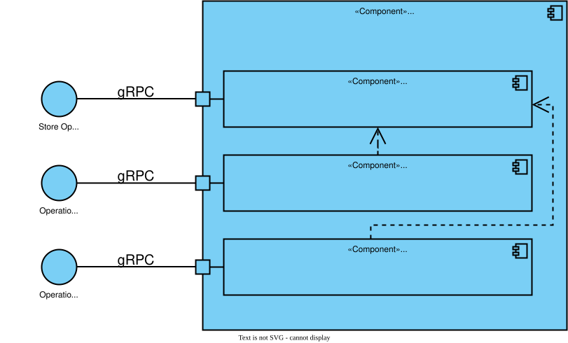
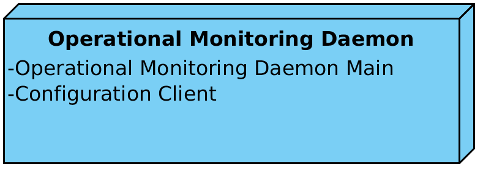

# X-Road: Operational Monitoring Daemon Architecture <!-- omit in toc -->

Version: 1.10  
Document ID: ARC-OPMOND

| Date       | Version | Description                                                           | Author             |
|------------|---------|-----------------------------------------------------------------------|--------------------|
|            | 0.5     | Initial version                                                       |                    |
| 23.01.2017 | 0.6     | Added license text, table of contents and version history             | Sami Kallio        |
| 02.02.2018 | 0.7     | Technology matrix moved to the ARC-TEC-file                           | Antti Luoma        |
| 05.03.2018 | 0.8     | Added terms and abbreviations reference and moved terms to term doc   | Tatu Repo          |
| 18.02.2019 | 0.9     | New optional field: xRequestId (string)                               | Caro Hautamäki     |
| 12.12.2019 | 1.0     | Update appendix A.2 with the updated fields                           | Ilkka Seppälä      |
| 25.06.2020 | 1.1     | Update section 3.3 with the instructions how to enable JMX            | Petteri Kivimäki   |
| 01.06.2023 | 1.2     | Update references                                                     | Petteri Kivimäki   |
| 02.10.2024 | 1.3     | Update schema file locations                                          | Justas Samuolis    |
| 05.12.2024 | 1.4     | Add endpoint level statistics gathering support                       | Eneli Reimets      |
| 17.03.2025 | 1.5     | Syntax and styling                                                    | Pauline Dimmek     |
| 26.03.2025 | 1.6     | Added field xRoadVersion and example for producer side REST request   | Eneli Reimets      |
| 10.07.2025 | 1.7     | Added info about operational data query in fixed intervals using gRPC | Mikk-Erik Bachmann |
| 11.11.2025 | 1.8     | Drop JMX interface                                                    | Justas Samuolis    |
| 15.01.2026 | 1.9     | Update schema file locations                                          | Mohamed Elbeltagy  |
| 15.10.2026 | 1.10    | Store and query over gRPC                                             | Eneli Reimets      |

## Table of Contents <!-- omit in toc -->

<!-- toc -->

- [License](#license)
- [1 Introduction](#1-introduction)
  - [1.1 Overview](#11-overview)
  - [1.2 Terms and Abbrevations](#12-terms-and-abbrevations)
  - [1.3 References](#13-references)
- [2 Component View](#2-component-view)
  - [2.1 Operational Monitoring Daemon Main](#21-operational-monitoring-daemon-main)
    - [2.1.1 Operational Monitoring Database](#211-operational-monitoring-database)
    - [2.1.2 Operational Monitoring Service](#212-operational-monitoring-service)
    - [2.1.3 Operational Monitoring gRPC Service](#213-operational-monitoring-grpc-service)
  - [2.2 Configuration Client](#22-configuration-client)
- [3 Protocols and Interfaces](#3-protocols-and-interfaces)
  - [3.1 Store Operational Monitoring Data](#31-store-operational-monitoring-data)
  - [3.2 Operational Monitoring Query](#32-operational-monitoring-query)
  - [3.3 Operational Monitoring Query in Fixed Intervals](#33-operational-monitoring-query-in-fixed-intervals)
  - [3.4 Download Configuration](#34-download-configuration)
- [4 Deployment View](#4-deployment-view)
- [Appendix A Store Operational Monitoring Data Messages](#appendix-a-store-operational-monitoring-data-messages)
  - [A.1 Protocol Buffers Definition of the Store Operational Monitoring Data Messages](#a1-protocol-buffers-definition-of-the-store-operational-monitoring-data-messages)
  - [A.2 Example Store Operational Monitoring Data Request](#a2-example-store-operational-monitoring-data-request)
  - [A.3 Store Operational Monitoring Data Response](#a3-store-operational-monitoring-data-response)
  - [A.4 Example Store Operational Monitoring Data Outcomes](#a4-example-store-operational-monitoring-data-outcomes)

<!-- tocstop -->

## License

This document is licensed under the Creative Commons Attribution-ShareAlike 3.0 Unported License. To view a copy of this license, visit http://creativecommons.org/licenses/by-sa/3.0/.

## 1 Introduction

The X-Road monitoring solution is conceptually split into two parts: environmental and operational monitoring. The operational monitoring processes operational statistics (such as which services or endpoints have been called, how many times, what was the size of the response, etc.) of the security servers.

This document describes the architecture of the X-Road operational monitoring daemon. It presents an overview of the components of the monitoring daemon and its interfaces.

This document is aimed at technical readers who want to acquire an overview of inner workings of the monitoring daemon.

### 1.1 Overview

The main function of the monitoring daemon is to collect operational data of the X-Road security server(s) and make it available for external monitoring systems (e.g., Zabbix, Nagios) via corresponding interfaces.

The monitoring daemon also depends on central server that provides the global configuration.

### 1.2 Terms and Abbrevations

See X-Road terms and abbreviations documentation \[[TA-TERMS](#Ref_TERMS)\].

### 1.3 References

<a name="ARC-G"/>**ARC-G** -- X-Road Architecture. Document ID: [ARC-G](../../Architecture/arc-g_x-road_arhitecture.md).  
<a name="PR-GCONF"/>**PR-GCONF** -- X-Road: Protocol for Downloading Configuration. Document ID: [PR-GCONF](../../Protocols/pr-gconf_x-road_protocol_for_downloading_configuration.md).  
<a name="PR-MESS"/>**PR-MESS** -- X-Road: Message Transport Protocol v4.0. Document ID: [PR-MESS](../../Protocols/pr-mess_x-road_message_protocol.md).  
<a name="PR-OPMON"/>**PR-OPMON** -- X-Road: Operational Monitoring Protocol. Document ID: [PR-OPMON](../Protocols/pr-opmon_x-road_operational_monitoring_protocol_Y-1096-2.md).   
<a name="UG-OPMONSYSPAR"/>**UG-OPMONSYSPAR** -- X-Road: Operational Monitoring System Parameters. Document ID: [UG-OPMONSYSPAR](../Manuals/ug-opmonsyspar_x-road_operational_monitoring_system_parameters_Y-1099-1.md).  
<a name="PSQL"/>**PSQL** -- PostgreSQL, https://www.postgresql.org/  
<a name="ARC-TEC"/>**ARC-TEC** -- X-Road technologies. Document ID: [ARC-TEC](../../Architecture/arc-tec_x-road_technologies.md).  
<a name="Ref_TERMS" class="anchor"/>**TA-TERMS** -- X-Road Terms and Abbreviations. Document ID: [TA-TERMS](../../terms_x-road_docs.md).


## 2 Component View

Figure 1 shows the main components and interfaces of the monitoring daemon. The components and the interfaces are described in detail in the following sections.



Technologies used in the operational monitoring daemon can be found here: [[ARC-TEC]](#ARC-TEC)

**Figure 1. Operational monitoring daemon component diagram**

### 2.1 Operational Monitoring Daemon Main

The operational monitoring daemon main is a standalone Java daemon application that implements the main functionality of the operational monitoring daemon.  

#### 2.1.1 Operational Monitoring Database

The operational monitoring database component collects operational monitoring data of the X-Road security server(s) via *store operational monitoring data* interface. Operational data is stored in a PostgreSQL [[PSQL]](#PSQL) database.

Outdated data records are deleted periodically from the database according to the monitoring daemon configuration.

#### 2.1.2 Operational Monitoring Service

The operational monitoring service receives and processes operational monitoring requests via *operational monitoring query* interface. There are two requests used by the security server(s) - *get operational monitoring data* and *get operational health data*.

In case the sender of the *get operational monitoring data* request is a regular client, only operational monitoring data records associated with that client are returned. In case the request sender is the central monitoring client (described in the global configuration) or owner of the current security server (described in the global configuration), it has access to all the records.

For performance purposes, the operational monitoring service limits the size of the *get operational monitoring data* response message. The maximum response size is configurable (however, all the records having the same timestamp as the last queried record are still included into the response). In case some queried records still do not fit into the response, the timestamp of the first excluded record is returned in the response to indicate overflow. The response must also fit into the message size limit of the security server's gRPC channel to the daemon (see [Section 3.2](#32-operational-monitoring-query)).

#### 2.1.3 Operational Monitoring gRPC Service

The operational monitoring gRPC service is the network interface of the monitoring daemon. It is a single gRPC service with three methods, one for each of the interfaces described in Section 3: *store operational monitoring data*, *operational monitoring query* and *operational monitoring query in fixed intervals*. The last one retrieves the number of successful and failed requests in fixed time intervals which can be used to visualize the request traffic in a graph.

The service listens on the address and port defined in the system parameters of the daemon (by default `127.0.0.1` and port 2081), see [[UG-OPMONSYSPAR]](#UG-OPMONSYSPAR). It accepts only TLS connections with client authentication unless TLS is turned off for the internal gRPC connections of the security server.

### 2.2 Configuration Client

The configuration client is responsible for downloading remote global configuration files. The source location of the global configuration is taken from the anchor file that was manually copied to the configuration directory of the operational monitoring daemon (or uploaded from the security server user interface in case monitoring daemon is deployed together with the security server).

The component is a standalone Java daemon application.

## 3 Protocols and Interfaces

### 3.1 Store Operational Monitoring Data

This protocol is used by the X-Road security server to store its cached operational monitoring data. The protocol is a synchronous RPC-style protocol based on gRPC: the security server calls the `StoreOperationalData` method of the operational monitoring gRPC service. The messages are defined in a protocol buffers file, see [Appendix A](#AppendixA).

The connection is secured with TLS and both sides are authenticated. The security server and the monitoring daemon use the shared internal gRPC identity of the security server that all internal gRPC connections of the security server use; there are no separate operational monitoring TLS certificates.

The gRPC channel of the security server to the monitoring daemon waits for the connection to become ready (*wait-for-ready*) instead of failing when the daemon is not reachable, and does not send keepalive pings. Every call has a deadline: the call fails if the daemon has not answered within the time defined by the parameter *deadline-after* of the channel (60 seconds by default), see [[UG-OPMONSYSPAR]](#UG-OPMONSYSPAR).

The availability of this service to the security server is not critical to operation of X-Road. If this service is unavailable, the security server continues caching in its memory buffer the operational data records and retries sending them. In case buffer overflow the oldest records are deleted.

The storing operational monitoring data is not time-critical, hence asynchronous caching of the records is performed in the security server side.

The security server splits the records into messages so that a message has at most the number of records and at most the number of bytes defined by system parameters. The monitoring daemon rejects a message that is larger than its inbound message size limit. The security server then sends the rejected records again in two halves, and drops a single record that the daemon still rejects as too large.

### 3.2 Operational Monitoring Query

The operational monitoring query interface is used by the security server to retrieve operational monitoring data. The X-Road operational monitoring protocol [[PR-OPMON]](#PR-OPMON) (based on [[PR-MESS]](#PR-MESS)) is used between the monitoring client and the security server. The security server passes the SOAP query message on as it is to the monitoring daemon by calling the `QueryOperationalData` method of the operational monitoring gRPC service. The request carries the query message and its content type. The request also has an access scope field, which is not used: the security server leaves it unset and the monitoring daemon ignores it. The monitoring daemon returns the response message, including a SOAP fault if the query failed, and its content type. The connection is secured and the channel behaves as described in [Section 3.1](#31-store-operational-monitoring-data).

The monitoring of the security servers is not the main functionality of the X-Road system, therefore the availability and responsiveness of this service is not paramount. Operational data records are held in the database and are available for configured days.

Because the channel waits for the connection to become ready, a query to a stopped or unreachable monitoring daemon does not fail at once. It fails when the deadline expires (60 seconds by default), and the security server returns the fault code `server.serverproxy.service_failed.network_error` to the client of the query.

The channel accepts a response up to a message size limit (16 MiB by default, at least 4 MiB). A query response that is larger fails with the fault code `server.serverproxy.service_failed.operational_data_response_too_large`. In that case the number of records in the response can be lowered or the limit raised, see [[UG-OPMONSYSPAR]](#UG-OPMONSYSPAR).

### 3.3 Operational Monitoring query in fixed intervals

This query is used by the Security Server to retrieve operational monitoring data in fixed intervals so that it can be used to visualize the request traffic in the UI. It will return the count of successful and failed requests in each time interval. The query is the `GetOperationalDataIntervals` method of the operational monitoring gRPC service, and the connection and the channel behave as described in [Section 3.1](#31-store-operational-monitoring-data).

### 3.4 Download Configuration

The operational monitoring daemon downloads the generated global configuration files from a configuration source.

The configuration download interface is a synchronous interface that is required by the operational monitoring daemon. It is provided by a configuration source such as a central server or a configuration proxy.

The interface is described in more detail in [[ARC-G]](#ARC-G) and [[PR-GCONF]](#PR-GCONF).

## 4 Deployment View

Figure 2 shows the deployment diagram.



**Figure 2. Operational monitoring daemon deployment**


<a name="AppendixA"/>

## Appendix A Store Operational Monitoring Data Messages

### A.1 Protocol Buffers Definition of the Store Operational Monitoring Data Messages

The operational monitoring gRPC service and its messages, including the store request and its records, are defined in the file *src/service/op-monitor/op-monitor-api/src/main/proto/opmonitor_service.proto* of the X-Road source code.

### A.2 Example Store Operational Monitoring Data Request

The example is an illustrative gRPC store request, shown in JSON notation for readability; on the wire the request is a protocol buffers message. Its field names and enum values follow the proto file named in Appendix A.1. The query response defined in [[PR-OPMON]](#PR-OPMON) is a different format with its own field names and values, for example `xRoadVersion` and `Client`. The monitoring daemon assigns the record identifier and the monitoring data timestamp when it stores a record, so they are not part of the request.

The first record of the store request reflects successfully mediated SOAP request, the second and the third one successfully mediated REST client and producer side requests and the fourth one unsuccessfully mediated request.

```json
{
  "records": [
    {
      "securityServerInternalIp": "fd42:2642:2cb3:31ac:216:3eff:fedf:85c%eth0",
      "securityServerType": "CLIENT",
      "requestInTs": 1576133360081,
      "requestOutTs": 1576133361160,
      "responseInTs": 1576133361818,
      "responseOutTs": 1576133361876,
      "clientXroadInstance": "FI",
      "clientMemberClass": "COM",
      "clientMemberCode": "111",
      "clientSubsystemCode": "CLIENT",
      "serviceXroadInstance": "FI",
      "serviceMemberClass": "COM",
      "serviceMemberCode": "111",
      "serviceSubsystemCode": "SERVICE",
      "serviceCode": "getRandom",
      "serviceVersion": "v1",
      "messageId": "1234",
      "messageUserId": "1234",
      "messageIssue": "1234",
      "messageProtocolVersion": "4.x",
      "clientSecurityServerAddress": "ss1",
      "serviceSecurityServerAddress": "ss1",
      "requestSize": 1226,
      "responseSize": 1539,
      "requestAttachmentCount": 0,
      "responseAttachmentCount": 0,
      "succeeded": true,
      "xRequestId": "d4490e7f-305e-44c3-b869-beaaeda694e7",
      "xroadVersion": "8.0.0",
      "serviceType": "WSDL"
    },
    {
      "securityServerInternalIp": "fd42:2642:2cb3:31ac:216:3eff:fedf:85c%eth0",
      "securityServerType": "CLIENT",
      "requestInTs": 1742471252081,
      "requestOutTs": 1742471252151,
      "responseInTs": 1742471252329,
      "responseOutTs": 1742471252379,
      "clientXroadInstance": "FI",
      "clientMemberClass": "COM",
      "clientMemberCode": "111",
      "clientSubsystemCode": "CLIENT",
      "serviceXroadInstance": "FI",
      "serviceMemberClass": "COM",
      "serviceMemberCode": "111",
      "serviceSubsystemCode": "SERVICE",
      "serviceCode": "pets",
      "restMethod": "GET",
      "messageId": "1234",
      "messageProtocolVersion": "1",
      "clientSecurityServerAddress": "ss1",
      "serviceSecurityServerAddress": "ss1",
      "requestSize": 214,
      "responseSize": 462,
      "requestAttachmentCount": 0,
      "responseAttachmentCount": 0,
      "succeeded": true,
      "statusCode": 200,
      "xRequestId": "1244d018-9300-4f1b-8c2b-9b7f2bc4e933",
      "xroadVersion": "8.0.0",
      "serviceType": "REST"
    },
    {
      "securityServerInternalIp": "fd42:2642:2cb3:31ac:216:3eff:fedf:85c%eth0",
      "securityServerType": "PRODUCER",
      "requestInTs": 1742471252251,
      "requestOutTs": 1742471252251,
      "responseInTs": 1742471252364,
      "responseOutTs": 1742471252364,
      "clientXroadInstance": "FI",
      "clientMemberClass": "COM",
      "clientMemberCode": "111",
      "clientSubsystemCode": "CLIENT",
      "serviceXroadInstance": "FI",
      "serviceMemberClass": "COM",
      "serviceMemberCode": "111",
      "serviceSubsystemCode": "SERVICE",
      "serviceCode": "pets",
      "restMethod": "GET",
      "restPath": "/cat/*",
      "messageId": "1234",
      "messageProtocolVersion": "1",
      "clientSecurityServerAddress": "ss1",
      "serviceSecurityServerAddress": "ss1",
      "requestSize": 214,
      "responseSize": 462,
      "requestAttachmentCount": 0,
      "responseAttachmentCount": 0,
      "succeeded": true,
      "statusCode": 200,
      "xRequestId": "1244d018-9300-4f1b-8c2b-9b7f2bc4e933",
      "xroadVersion": "8.0.0",
      "serviceType": "REST"
    },
    {
      "securityServerInternalIp": "fd42:2642:2cb3:31ac:216:3eff:fedf:85c%eth0",
      "securityServerType": "CLIENT",
      "requestInTs": 1576134507705,
      "requestOutTs": 1576134507840,
      "responseInTs": 1576134508040,
      "responseOutTs": 1576134508045,
      "clientXroadInstance": "FI",
      "clientMemberClass": "COM",
      "clientMemberCode": "111",
      "serviceXroadInstance": "FI",
      "serviceMemberClass": "COM",
      "serviceMemberCode": "111",
      "serviceCode": "getSecurityServerHealthData",
      "serviceVersion": "v1",
      "messageId": "1234",
      "messageProtocolVersion": "4.x",
      "clientSecurityServerAddress": "ss1",
      "serviceSecurityServerAddress": "ss1",
      "requestSize": 1767,
      "requestAttachmentCount": 0,
      "succeeded": false,
      "faultCode": "Server.ServerProxy.OpMonitor.InvalidClientIdentifier",
      "faultString": "Missing required subsystem code",
      "xRequestId": "2c51b181-47cd-4ff2-b5df-6463f968fd0c",
      "xroadVersion": "8.0.0",
      "serviceType": "WSDL"
    }   
  ]
}
```

### A.3 Store Operational Monitoring Data Response

The response message of the store request is empty. The outcome of the call is given by the gRPC status of the call.

### A.4 Example Store Operational Monitoring Data Outcomes

| gRPC status | Meaning |
|-------------|---------|
| `OK` | The records were stored. |
| `RESOURCE_EXHAUSTED` | The request is larger than the inbound message size limit of the monitoring daemon. |
| `DEADLINE_EXCEEDED` | The monitoring daemon did not answer within the deadline of the channel, for example because it is stopped. |

In case of any status other than `OK` the security server keeps the records in its buffer and sends them again later, except for the records that the monitoring daemon rejects as too large (see [Section 3.1](#31-store-operational-monitoring-data)).
